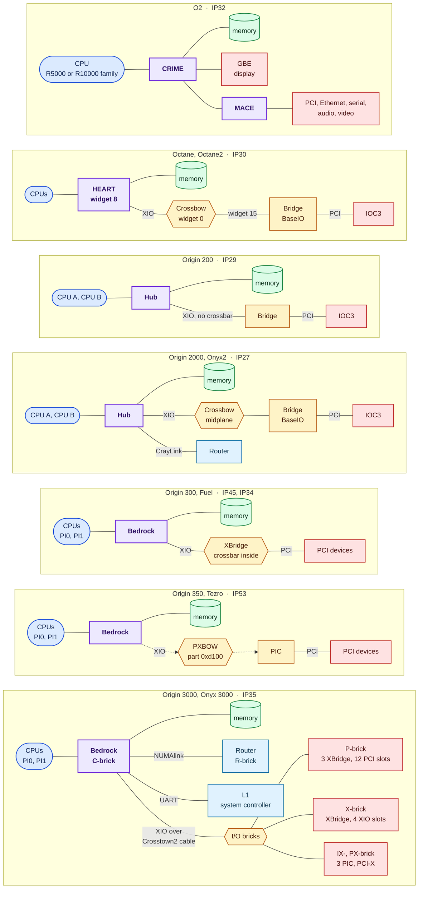

# chips

Register maps for the chips inside SGI's MIPS machines (O2, Octane, Origin, Onyx, Fuel and Tezro) and its
IA-64 Altix and Prism machines.

Most of SGI's own silicon has no public datasheet, so this is worked out the long way. IRIX 6.5.30's kernels,
PROMs and diags, the public IRIX source, old SGI manuals and the Linux and BSD drivers all get read, and every
fact notes where it came from and whether it's established, inferred or still unknown.

What comes out the other end is headers you can build against, in C, Rust, Python, JSON and XML.

## Chips

- **O2:** CRIME, GBE, MACE and VICE. These ones have published specs to check against.
- **Octane:** HEART, the BaseIO board and the PCI module.
- **Origin 200, Origin 2000, Onyx2:** the Hub, the routers, and the XIO boards (MENET, MSCSI, the PCI shoebox
  and shoehorn).
- **Origin 300, Origin 3000, Fuel, Tezro:** the Bedrock, PIC, the routers and the L1.
- **Altix 350, 330, 3000, 3700, 4700, 450 and Prism (SN2):** the SHub, the TIO bridges, PIC, IOC4 and the routers. So
  far there are machine pages and cross-checks of the I/O chips against SGI's Linux code; the SHub has a partial
  register map in [devices/shub/](devices/shub/README.md).
- **Crosstalk and I/O:** the XIO link, Crossbow, Bridge, XBridge, IOC3 and IOC4.
- **CPUs:** the R5000, and the R10000 family through to the R16000.
- **The rest:** SCSI, Ethernet, USB, FireWire and audio controllers, clocks, NVRAM, flash, and the Indy's
  Ethernet while we were there.

Every chip has a page under [devices/](devices/README.md). Machines and bricks are under
[platforms/](platforms/README.md); the Altix and Prism machines are in [platforms/sn2/](platforms/sn2/README.md).
Wire formats are under [formats/](formats/README.md), and the firmware and kernel code is under [software/](software/README.md).

## How they fit together

<!-- Question: what does each machine family's node look like, from processors and memory out to I/O, and which chip
sits where? A reader of a device page needs to know what is upstream of the chip before an address or an interrupt
makes sense.
Evidence: devices/hub_pi/README.md (the node's two processors), devices/hub_md, devices/bedrock_pi/README.md (PI0 and PI1,
two processors each), devices/bedrock_md, devices/heart/README.md (memory controller, XIO port), devices/crime/README.md
and devices/mace/README.md (O2 memory and I/O), devices/r5000/README.md (O2 R5000), devices/crosstalk/host-ends.md 2.1
(HEART widget 8, Crossbow widget 0, BaseIO Bridge widget 15), devices/xbow/family.md (parts 0x0000, 0xd000, 0xd100; no
crossbar in the Origin 200 base; midplane Crossbow), devices/baseio/README.md, devices/router/README.md,
devices/bedrock_ni/README.md (NUMAlink), devices/l1/README.md (UART), platforms/bricks/pbrick.md, xbrick.md, ixbrick.md and pxbrick.md (I/O bricks and their
bridge chips), devices/crosstown-ktown/README.md. Dotted edges are inferred. -->


Blue is CPUs, green is memory, purple is SGI's node chips, yellow is crossbars and bridges, red is I/O.

## Using it

The headers and the crate live in [generated/](generated/). Don't edit them; they're built from the
`registers.toml` next to each device page.

To run the checks yourself:

```sh
git clone https://github.com/jamesbraid/chips && cd chips
tools/setup-clone.sh --root /path/to/your/irix/files
retools/tools/re-run retools/tools/defs/ci-check
```

You'll need Podman, git, python3 and your own IRIX 6.5.30 files. [references/irix-files.md](references/irix-files.md)
lists which ones.

## How far along

Still a long way to go on the functions. The open questions are in [questions/](questions/README.md).
If you spot a mistake or have a manual we don't, [open an issue](https://github.com/jamesbraid/chips/issues).

<!-- coverage:begin. Regenerate: retools/tools/re-run python3 retools/tools/inventory.py, then re-extract these rows from COVERAGE.md. Never type them. -->
| Table | Rows | % understood | % located or better |
|---|---:|---:|---:|
| [binaries](generated/inventory/binaries.tsv) | 3092 | 20.2 | 20.4 |
| [functions](generated/inventory/functions.tsv) | 6836 | 17.5 | 74.4 |
| functions (distinct names) | 2570 | 25.2 | 97.7 |
| [mmio](generated/inventory/mmio.tsv) | 87 | 70.1 | 70.1 |
| [ioctls](generated/inventory/ioctls.tsv) | 6 | 100.0 | 100.0 |
| [spec-registers](generated/inventory/spec-registers.tsv) | 174 | 100.0 | 100.0 |
<!-- coverage:end -->

## License

[BSD 3-Clause](LICENSE). The `retools/` scripts started life as gr4's and keep its notice. No SGI binaries in
here; bring your own.

## Credits

James Braid, plus a lot of Claude and Codex reading MIPS disassembly so I didn't have to.

Thanks to -

* Dominik Behr ([@techomancer](https://github.com/techomancer)) for [gr2](https://github.com/techomancer/gr2)
  and [gr4](https://github.com/techomancer/gr4), where the layout and working style come from
* The Linux-MIPS, OpenBSD and NetBSD folks, whose SGI ports get checked against constantly
* MAME and GXemul, for second opinions on how the hardware behaves
* Everyone keeping SGI manuals, `hinv` dumps and IRIX media online
